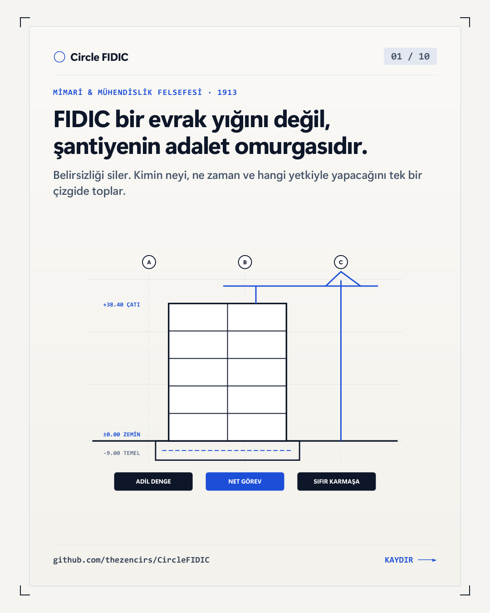
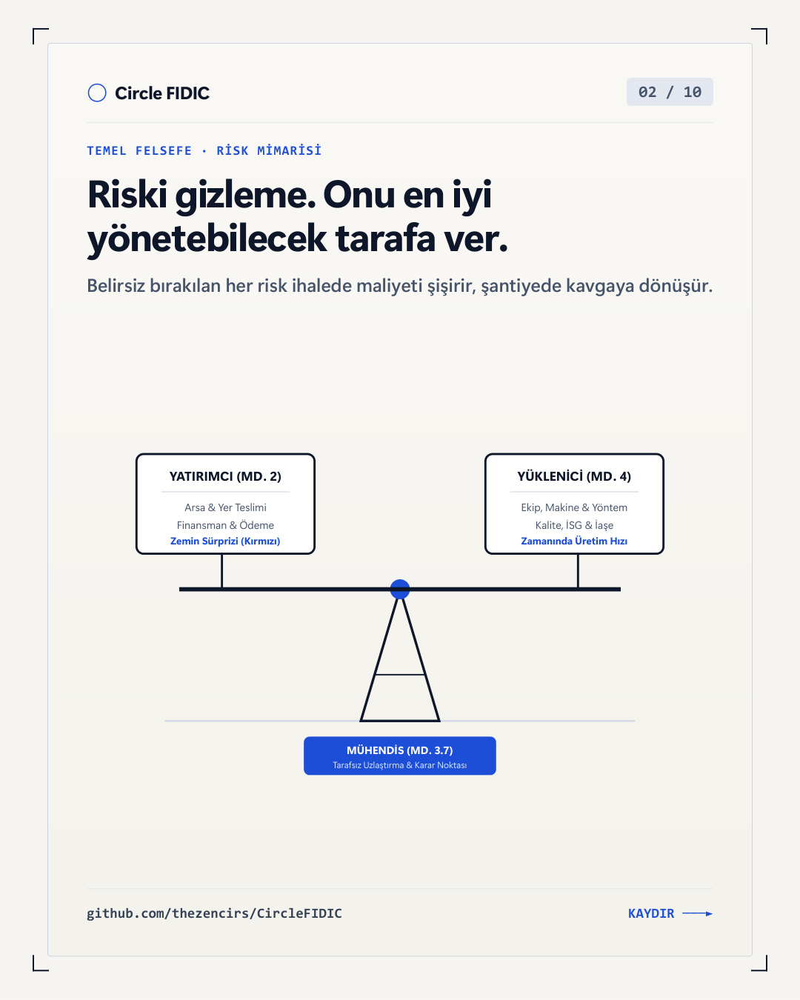
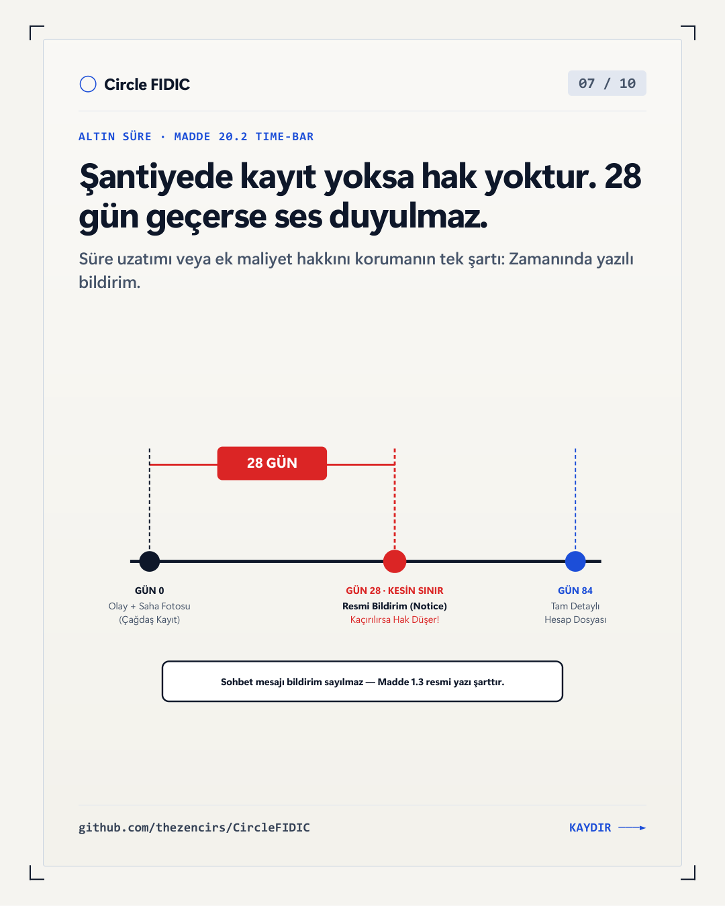
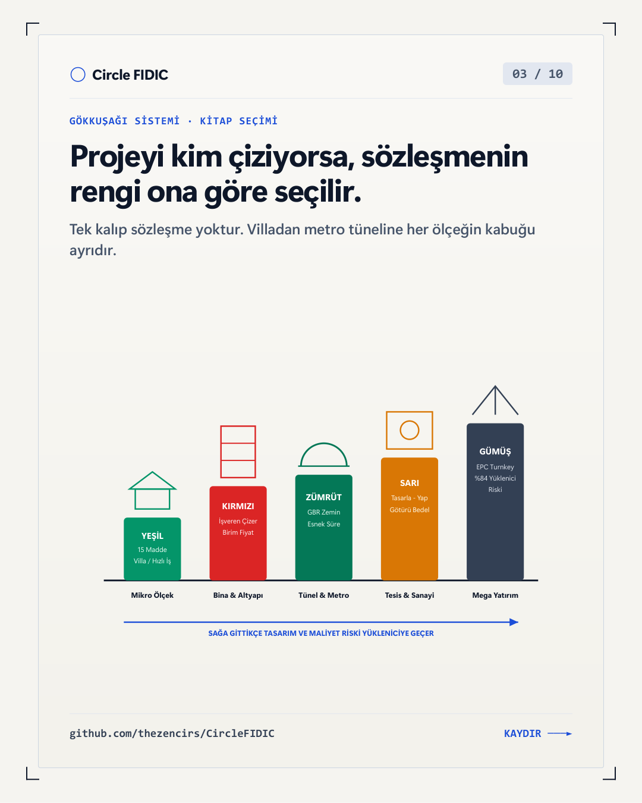
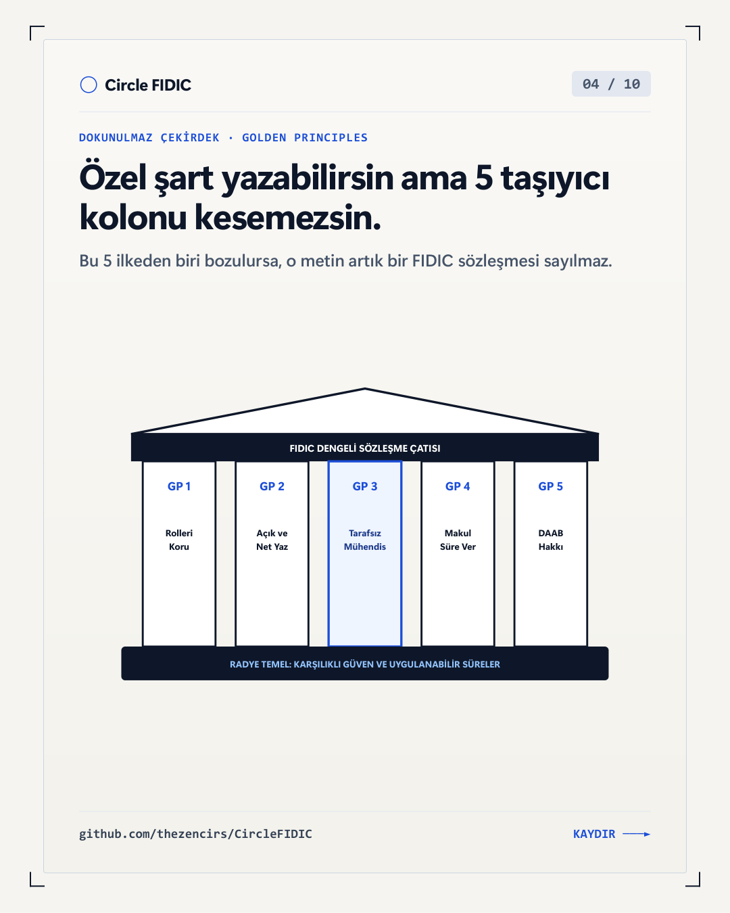
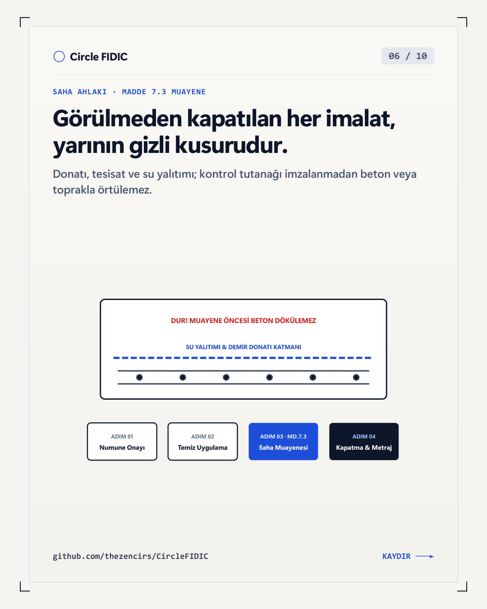
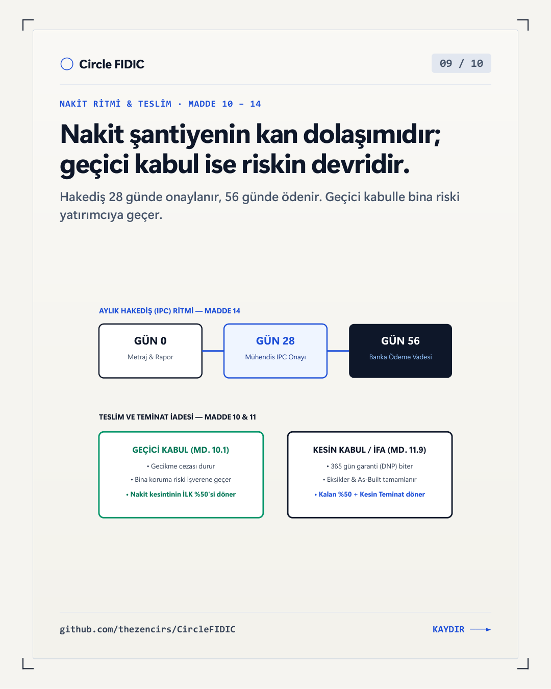

<div align="center">

# ◯ Circle FIDIC — Minimalist FIDIC-Shell Project & Site OS

**A minimalist, architectural-grade construction & engineering operating system built on the FIDIC philosophy — from single-villa renovations to city-scale infrastructure, in a `1.3 MB` Windows `.exe` + Live Web & Mobile PWA.**

**TR:** *FIDIC felsefesini yazıya ve menü karmaşasına boğmadan şantiyeye indiren; yatırımcı, yürütücü, mimar, şantiye şefi ve sahadaki ustanın ayrı girişlerle kullandığı açık kaynak masaüstü (`.exe`), web ve mobil proje işletim sistemi.*

[](https://github.com/thezencirs/CircleFIDIC/releases/latest)
[](#quick-start)
[](#architecture)
[](#)
[](LICENSE)
[](https://github.com/thezencirs)

<br/>

<p align="center">
  
  
  
</p>

</div>

---

## 📐 FIDIC Is Not Bureaucracy — It Is Site Philosophy

Most construction platforms drown teams in 50 disconnected enterprise menus while leaving contractual rights unprotected. **Circle FIDIC** distills the international FIDIC backbone into **6 clean architectural stages**:

| Stage | Core Principle | FIDIC Spine | Live Digital Automation |
| :---: | :--- | :---: | :--- |
| **01** | **Setup & Site Access** | `Cl. 1 – 4` | Priority of documents, Performance Security (`28d`), Site Access & Financial proof |
| **02** | **Site, Crew, Catering & QA** | `Cl. 5 – 7` | Pre-pour inspection gate (`Cl. 7.3`), daily crew headcount vs 4-shift meal audit (`Cl. 6.6`) |
| **03** | **Velocity & Weather** | `Cl. 8` | `Hour · Day · Week · Month · Year` S-Curve, crane wind safety & `Cl. 8.5(c)` weather EOT |
| **04** | **Valuation & Cashflow** | `Cl. 12 – 14` | `28d` IPC certification, `56d` payment clock, live `Pn` escalation & `Hudson` calculators |
| **05** | **Handover & Defects** | `Cl. 9 – 11` | Blueprint snag pinning (`#E`), `50% + 50%` retention release & `365d` DNP closure |
| **06** | **28-Day Shield & DAAB** | `Cl. 15 – 21` | Automated **28-day Time-Bar** countdowns & formal bilingual (`TR`/`EN`) Notice generator |

---

## 🗂️ 10-Card Minimalist FIDIC Philosophy Deck (`1080×1350` 4:5)

Included inside [`wwwroot/carousel/`](wwwroot/carousel/) and built directly into the application's **FIDIC Philosophy & Cards** studio:

<p align="center">
  
  
  
  
</p>

---

## 👥 5 Role-Tailored Logins (Zero Clutter)

- **Investor / Employer (`Cl. 2`):** Capital burn, `CPI` / `SPI` health, predicted finish date, variation approvals, and live site media.
- **Project Director / Engineer (`Cl. 3`):** Micro-to-City WBS, responsibility matrix, `28d / 42d / 84d` FIDIC clocks, and neutral determinations.
- **Lead Architect (`Cl. 5`):** Revision-sealed blueprints (`Rev.02 Current`), interactive floor-plan defect pinning, and field RFIs.
- **Site Manager (`Cl. 4 & 6`):** Hourly shift stream, manpower/plant counters, 4-shift catering vs attendance check, and live weather suitability.
- **Field Master / Foreman (`Mobile Focus Mode`):** Hides office complexity — large touch buttons (`25% · 50% · 75% · 100%`), instant photo/video upload, crew meal count, and snag fixes.

---

## 🚀 Quick Start

### Option 1 — Portable Single `.exe` (Windows 10/11)
Download **[`CircleFIDIC.exe`](https://github.com/thezencirs/CircleFIDIC/releases/latest)** (`~1.36 MB`) and double-click. It opens a native desktop window **and** broadcasts a local Wi-Fi PWA URL (`http://<LAN-IP>:4580`) so phones and tablets on site can connect instantly with zero install.

### Option 2 — Build from Source (`.NET 10`)
```powershell
git clone https://github.com/thezencirs/CircleFIDIC.git
cd CircleFIDIC
powershell -ExecutionPolicy Bypass -File .\build.ps1
```

---

## 🧩 Part of the Circle Zero-Bloat Windows Suite (`by @thezencirs`)

| Tool | Size | Purpose |
| :--- | :---: | :--- |
| 📐 **[CircleFIDIC](https://github.com/thezencirs/CircleFIDIC)** | `~1.3 MB` | **Minimalist FIDIC-Shell Construction & Project OS** (`.exe` + Web + Mobile PWA) |
| 📌 **[CircleTools](https://github.com/thezencirs/CircleTools)** | `~31 KB` | Pin any window **Always-on-Top** (`Win + Ctrl + T`) with click-through border |
| 🪢 **[CircleLine](https://github.com/thezencirs/CircleLine)** | `~85 KB` | **0-RAM Pendulum Desktop Clothesline** & `.webp`→`.png` CAD/3D drag bridge |
| 🖼️ **[CircleRef](https://github.com/thezencirs/CircleRef)** | `~55 KB` | **Infinite-Canvas Reference Board** for architects & designers |
| 📦 **[CircleRar](https://github.com/thezencirs/CircleRar)** | `~45 KB` | **Clean Windows 11 Archive Manager** (`RAR`, `ZIP`, `7z`, `ISO`) |
| 🎬 **[CircleMixRecord](https://github.com/thezencirs/CircleMixRecord)** | Studio | **Dual-Canvas (16:9 + 9:16) Recorder**, **Circle Meet** & **60 FPS Timelapse Studio** |

---

## ⚖️ License & Trademark Disclaimer

Released under the **[MIT License](LICENSE)** — Copyright (c) 2026 **thezencirs**.  
*FIDIC® is a registered trademark of the International Federation of Consulting Engineers. Circle FIDIC is an independent open-source software workflow tool and educational visual guide created by thezencirs and is not affiliated with or endorsed by FIDIC; no copyrighted FIDIC contract texts are distributed in this repository.*
